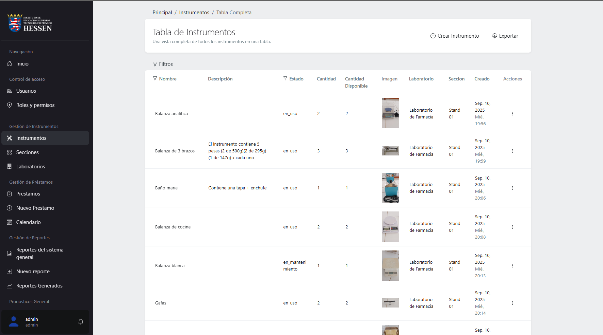
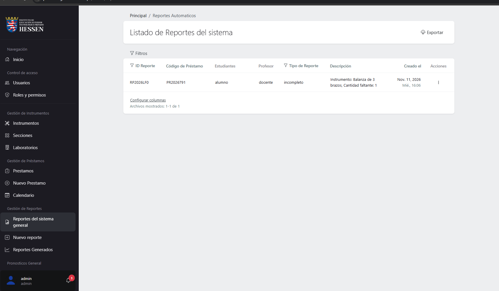
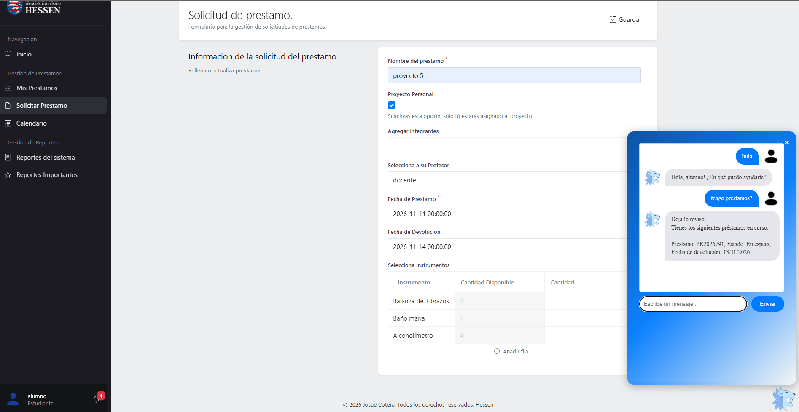

# 🔬 Sistema de Control de Préstamos e Inventario de Laboratorio


Sistema web para **gestionar el inventario y los préstamos de instrumentos de laboratorio** de un instituto. Proyecto final de la carrera de Ingeniería de Software con IA en **SENATI**.

Incluye **tres tipos de usuario** con permisos distintos y un **prototipo de chatbot en Python** para consultar y crear préstamos conversando.

---

## 🖼️ Capturas

<!-- Usa DATOS FICTICIOS en todas las capturas. -->

| Login | Panel del administrativo |
|---|---|
|  |  |

| Inventario de instrumentos | Solicitud de préstamo (alumno) |
|---|---|
|  |  |

| Validación de préstamos (docente) | Reportes |
|---|---|
|  |  |

| Chatbot en Python | Calendario de prestamos | 
|---|---|
|  |  

---

## 🎯 El problema

Los préstamos de instrumentos del laboratorio se controlaban de forma manual: era difícil saber qué había disponible, quién tenía cada equipo y quién lo debía devolver.

## ✅ La solución

Un sistema único donde el alumno **solicita**, el docente **valida** y el personal administrativo **controla el inventario y los reportes**.

## 👥 Roles y permisos

| Rol | Qué puede hacer |
|---|---|
| **Administrativo** | Gestiona el inventario, los usuarios y los permisos. Consulta reportes. |
| **Docente** | Revisa y valida (aprueba o rechaza) las solicitudes de préstamo. |
| **Alumno** | Consulta instrumentos disponibles y solicita préstamos. |

## ✨ Funcionalidades

- 📦 **Inventario** de instrumentos y equipos.
- 📝 **Solicitud y validación de préstamos** con flujo de aprobación.
- 🔐 **Sistema de roles y permisos** por tipo de usuario.
- 📊 **Reportes** de préstamos e inventario.
- 🤖 **Chatbot (prototipo)** en Python para consultar y crear préstamos de instrumentos.
- <!-- TODO: agrega lo que falte: devoluciones, estados (pendiente/aprobado/devuelto), exportar a Excel/PDF, alertas de retraso, etc. -->

## 🛠️ Tecnologías

| Capa | Tecnología |
|---|---|
| Backend | PHP, **Laravel** |
| Panel y permisos | **Laravel Orchid** |
| Frontend | JavaScript, Blade |
| Base de datos | <!-- TODO: MySQL / MariaDB --> |
| Chatbot | **Python** <!-- TODO: librerías: requests, FastAPI, etc. --> |
| Control de versiones | Git y GitHub |

## 🗂️ Estructura

```
├── app/               # Lógica de la aplicación (modelos, controladores, pantallas Orchid)
├── database/          # Migraciones y seeders
├── resources/         # Vistas y recursos
├── routes/            # Rutas
├── chatbot/           # Prototipo de chatbot en Python  
└── img/          # Capturas para este README
```

## 🚀 Posibles mejoras

- Notificaciones por correo para aprobaciones y devoluciones.

## 👤 Autor

**Josué Cotera Bravo** — Estudiante de Ingeniería de Software (UTP) · Técnico en Ingeniería de Software con IA (SENATI)

- 📧 josuecotb@gmail.com
- 💼 LinkedIn: [Josue C](www.linkedin.com/in/josue-cotera-bravo-a92358336)<!-- TODO: tu enlace -->
- 🐙 GitHub: [@jost3](https://github.com/jost3)
