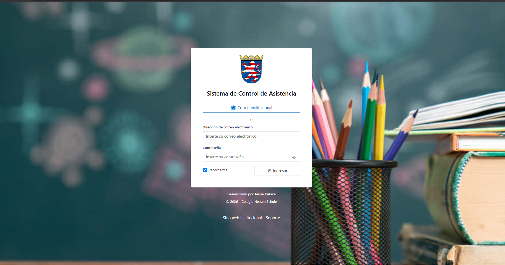
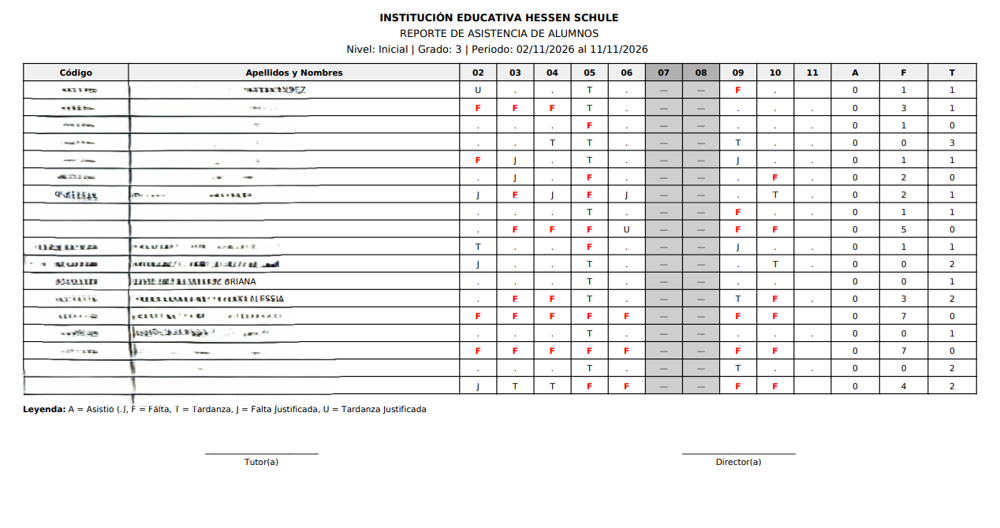

# 📱 QR_ASISTE — Sistema de control de asistencia por QR

Sistema web de **asistencia escolar mediante códigos QR**. Reemplaza el registro manual en papel: cada alumno tiene un QR y su asistencia se registra al escanearlo, quedando disponible al instante para la institución.

Lo desarrollé **desde cero** y está **desplegado y en uso real** en una institución educativa, donde sigo manteniéndolo y agregando funcionalidades.

> 🔒 **Sobre este repositorio:** el sistema está en producción con datos reales de una institución, por lo que el código fuente es privado. Este repositorio documenta el proyecto con capturas (con datos de demostración).

---

## 🖼️ Capturas

<!-- Todas las capturas deben usar DATOS FICTICIOS (nombres, DNI, correos). -->

| Inicio de sesión | Panel principal |
|---|---|
|  |  |

| Registro de asistencia por QR | Gestión de usuarios |
|---|---|
|  |  |

| Reporte de asistencia |
|---|
|  |

---

## 🎯 El problema

El control de asistencia en papel es lento, propenso a errores y difícil de consultar. Los docentes pierden tiempo al inicio de clase y la institución no tiene un historial fácil de revisar.

## ✅ La solución

Un sistema web donde:

- Cada alumno cuenta con un **código QR** único.
- La asistencia se **registra al escanear el código**, con fecha y hora.
- Administración y docentes **consultan la asistencia** desde un panel.

## ✨ Funcionalidades

- Registro de asistencia mediante escaneo de código QR.
- Gestión de usuarios (alta, edición y baja).
- Base de datos con historial de asistencia.
- Panel administrativo construido con **Laravel Orchid**.
- Reportes /exportacion de asistencia
- modulo de feriados

## 🛠️ Tecnologías

| Capa | Tecnología |
|---|---|
| Backend | PHP, **Laravel** |
| Panel administrativo | **Laravel Orchid** |
| Base de datos | MySQL  |
| Frontend | Blade, JavaScript, librería de lectura de QR |
| Despliegue | Hosting con dominio propio, en producción |

## 🚀 Estado y próximos pasos

- ✅ En producción y en uso diario.
- 🔄 En evolución constante, con nuevas funcionalidades.

## 👤 Autor

**Josué Cotera Bravo** — Estudiante de Ingeniería de Software (UTP) · Técnico en Ingeniería de Software con IA (SENATI)

- 📧 josuecotb@gmail.com
- 💼 LinkedIn: [Josue C](www.linkedin.com/in/josue-cotera-bravo-a92358336)
- 🐙 GitHub: [@jost3](https://github.com/jost3)
